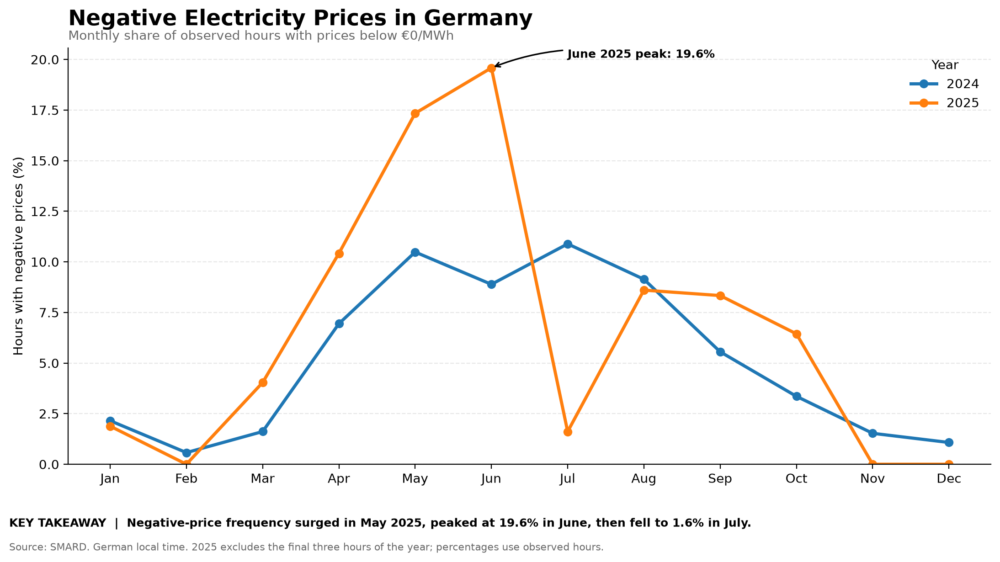
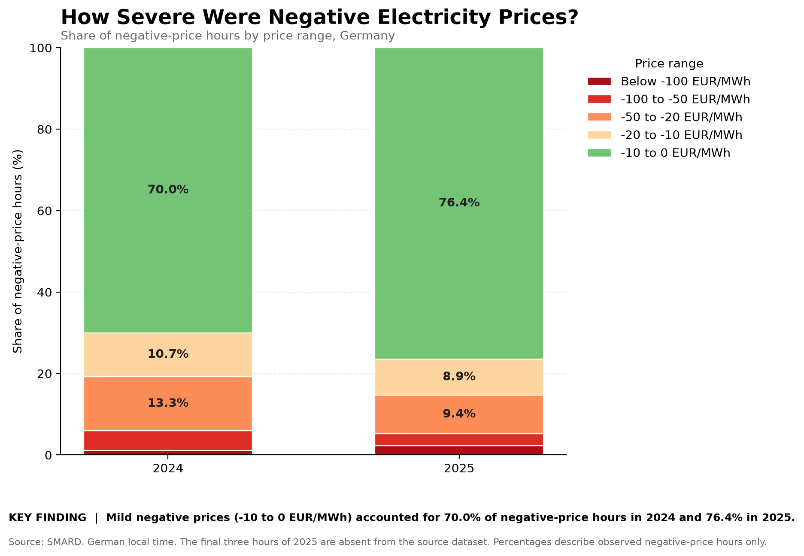
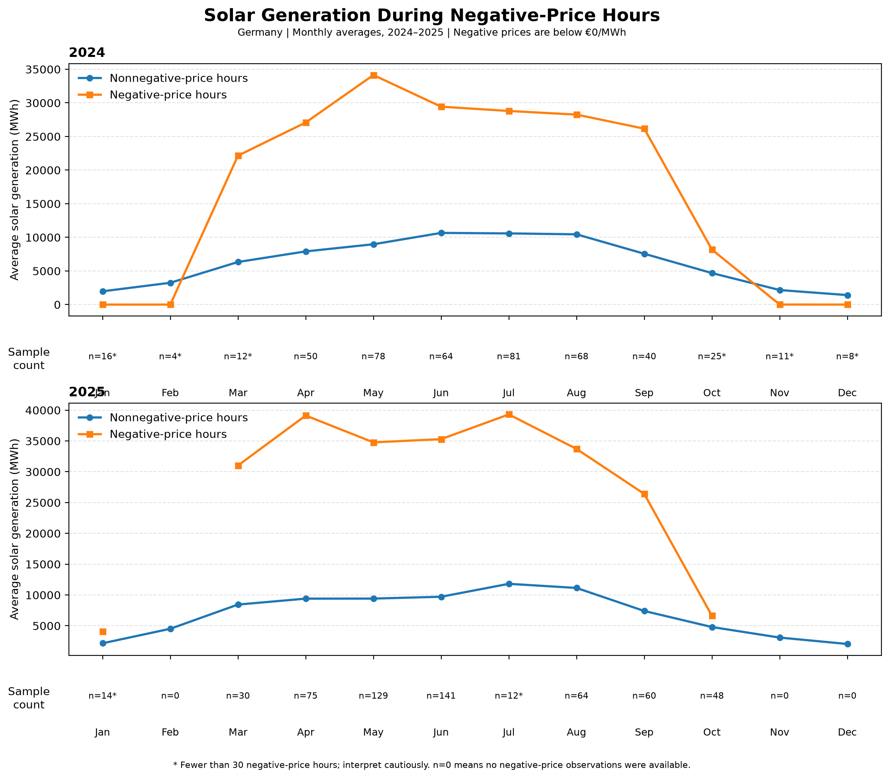
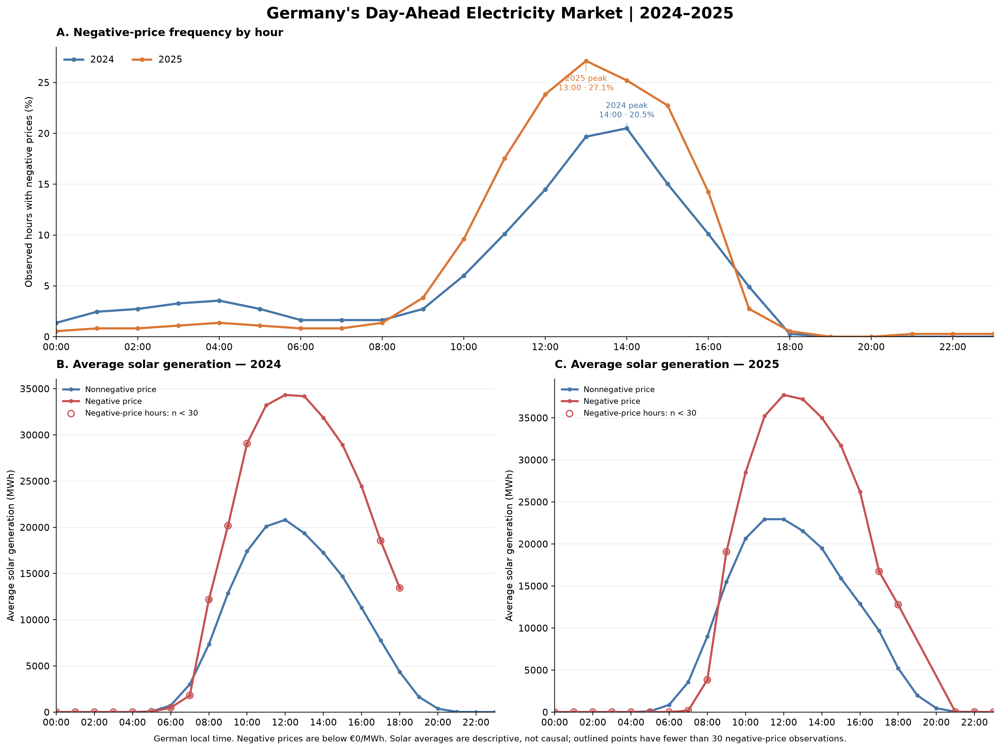

# GridSignal AI

**German Electricity Market Analytics | Python · pandas · Data Validation · Data Visualization**

GridSignal AI is a data analytics project investigating negative electricity prices in Germany and their relationship with wind and solar generation. It transforms hourly electricity-market data into validated datasets, quantitative findings, and visualizations to help explain market patterns.

The current implementation is a reproducible Python analytics pipeline analyzing German day-ahead electricity prices and selected renewable-generation data for 2024–2025. The longer-term vision is to extend this analytical foundation with forecasting, evidence retrieval, and AI-assisted market explanations.

## Project at a Glance

| Category | Details |
|---|---|
| Market | Germany's day-ahead electricity market |
| Analysis period | 2024–2025 |
| Data source | [SMARD](https://www.smard.de/en) |
| Core technologies | Python, pandas, matplotlib, pytest |
| Analytical focus | Negative prices, renewable generation, seasonality, hourly patterns |
| Current status | Data processing, analysis, validation, and visualizations implemented |
| Future direction | Forecasting, evidence retrieval, and AI-assisted explanations |

## Key Results

### 1. Negative-price hours increased by 25.4%

The dataset contains 457 negative-price hours in 2024 and 573 in 2025, an increase of 116 hours.

June showed a particularly pronounced change:

| Metric | June 2024 | June 2025 |
|---|---:|---:|
| Negative-price hours | 64 | 141 |
| Share of observed hours | 8.89% | 19.58% |

June 2025 had the highest observed monthly negative-price frequency in the dataset. The frequency subsequently fell to 1.61% in July 2025, highlighting substantial month-to-month variation.

These patterns identify periods worth investigating, but the analysis does not independently explain the underlying market conditions.

### 2. Solar generation was substantially higher during negative-price hours

Average solar generation was higher during negative-price hours in both years.

| Year | Negative-price hours | Average solar generation | Nonnegative-price hours | Average solar generation |
|---|---:|---:|---:|---:|
| 2024 | 457 | 25,540 MWh | 8,327 | 6,217 MWh |
| 2025 | 573 | 31,266 MWh | 8,184 | 6,880 MWh |

In 2025, average solar generation during negative-price hours was approximately 4.5 times the average during nonnegative-price hours.

These values are averages per observed hourly interval, not total generation. The relationship is descriptive and does not establish causation. Demand, conventional generation, cross-border flows, storage, and other market conditions may also influence electricity prices.

### 3. Most negative-price hours remained in the mildest negative range

| Negative-price range | 2024 hours | Share | 2025 hours | Share |
|---|---:|---:|---:|---:|
| Below −100 €/MWh | 5 | 1.1% | 13 | 2.3% |
| −100 to −50 €/MWh | 22 | 4.8% | 17 | 3.0% |
| −50 to −20 €/MWh | 61 | 13.3% | 54 | 9.4% |
| −20 to −10 €/MWh | 49 | 10.7% | 51 | 8.9% |
| −10 to 0 €/MWh | 320 | 70.0% | 438 | 76.4% |

Although negative-price hours became more frequent, most remained between −10 and 0 €/MWh.

The annual minimum price reached −135.45 €/MWh in 2024 and −250.32 €/MWh in 2025. This illustrates why the frequency of negative prices and their severity should be analyzed separately.

### 4. The solar-generation relationship was consistent across selected months

Across the 13 year-month combinations with at least 30 negative-price hours, average solar generation was higher during negative-price hours in all 13 cases.

- Mean difference: approximately 20,334 MWh per observed hourly interval.
- Median difference: approximately 19,168 MWh per observed hourly interval.
- Consistency: 13 out of 13 selected year-month combinations.

The 30-hour threshold is a practical inclusion rule, not a statistical significance test. These results support a consistent descriptive pattern within the selected observations but do not prove that solar generation caused negative prices.

### 5. Negative-price frequency peaked around midday

The hour with the highest negative-price frequency differed between years:

- **2024:** 14:00 German local time — 75 negative-price hours out of 366 observed hours, or 20.49%.
- **2025:** 13:00 German local time — 99 negative-price hours out of 365 observed hours, or 27.12%.

The peak frequency was approximately 6.63 percentage points higher in 2025.

The midday concentration is a useful pattern for further investigation, particularly alongside solar-generation data. It does not establish the cause of negative prices.

### 6. The hourly comparison showed higher solar generation during negative-price hours

At 11:00 German local time in 2025, average solar generation was approximately:

- 35,216 MWh during negative-price hours.
- 22,946 MWh during nonnegative-price hours.

The difference was approximately 12,270 MWh, or 53%.

Some overnight hour-of-day comparisons contain relatively few negative-price observations. Those comparisons should be interpreted cautiously, especially where fewer than 30 negative-price observations are available.

## Visualizations

The following charts summarize the main analytical findings.

### Monthly negative-price frequency



Compares the share of observed hourly intervals with day-ahead prices below 0 €/MWh for each month in 2024 and 2025.

### Negative-price severity



Compares the annual distribution of negative-price hours across five price-severity ranges.

### Monthly solar-generation comparison



Compares average solar generation across months and price categories. Values represent average generation per observed interval, not monthly totals.

### Hour-of-day analysis



Shows negative-price frequency by German local hour and compares average solar generation during negative-price and nonnegative-price hours.

For additional results, supporting tables, and analytical interpretation, see [the detailed findings](docs/findings.md).

## Why These Findings Matter

Negative electricity prices are relevant to the analysis of electricity-market conditions, renewable generation, and price variability.

The observed patterns suggest several useful directions for further investigation:

- **Market monitoring:** Identify months and hours with elevated negative-price frequency.
- **Renewable-generation analysis:** Examine how wind and solar output coincide with different price conditions.
- **Forecasting:** Investigate whether time, seasonality, and renewable-generation features improve baseline price forecasts.
- **Evidence-grounded explanations:** Connect quantitative results to official market reports and regulatory documents.

These are potential applications of the findings, not demonstrated operational outcomes. The current implementation is descriptive and does not yet provide price forecasts or an AI-generated market-intelligence service.

## Data Sources

**Primary source:** [SMARD — Germany's electricity market data platform](https://www.smard.de/en)

The project uses hourly data for the Germany/Luxembourg bidding zone:

- Day-ahead electricity prices (€/MWh).
- Actual offshore wind generation.
- Actual onshore wind generation.
- Actual solar generation.

The selected generation measures do not represent total electricity supply or every renewable energy source.

## Data Quality and Limitations

Data validation is an important part of this project because timestamp errors, incomplete observations, and incorrect joins can distort market analysis.

The current dataset has the following characteristics:

- **2024:** 8,784 hourly records, covering the leap year.
- **2025:** 8,757 hourly records; the final three hours of the year are absent from the downloaded source data.
- **Combined dataset:** 17,541 matched hourly price and generation records.
- **Timestamp matching:** Price and generation records are joined using UTC timestamps.
- **Local-time analysis:** `Europe/Berlin` is used for calendar-year, monthly, seasonal, and hour-of-day analysis.
- **Daylight saving:** Local months and individual local hours can contain different numbers of observations.
- **Negative-price frequency:** Calculated using observed hourly records as the denominator.
- **Unavailable comparisons:** Months without negative-price hours cannot support comparisons between negative-price and nonnegative-price hours.
- **Small sample sizes:** Some hour-of-day comparisons contain relatively few negative-price observations.
- **Causality and significance:** The analysis is descriptive and does not establish causal relationships or demonstrate statistical significance.
- **Source definitions:** Generation values follow the downloaded source data. Units, definitions, and any estimates should be verified before publication or commercial interpretation.

These limitations matter when comparing periods, interpreting averages, and drawing conclusions about market behavior. In particular, observed associations between renewable generation and negative prices should not be interpreted as proof of causation.

## Methodology

The current workflow follows seven stages.

1. **Inspect:** Examine source files, columns, timestamp formats, and data quality.
2. **Clean:** Parse timestamps and numerical values, handle missing data, and normalize timestamps.
3. **Validate:** Check required columns, timestamp uniqueness, missing intervals, and matching price and generation records.
4. **Combine:** Join prices and selected generation measures using UTC timestamps.
5. **Analyze:** Calculate negative-price frequency, compare generation across price categories, examine price severity, and summarize patterns by month, season, and hour of day.
6. **Visualize:** Generate charts that communicate the principal patterns and support further investigation.
7. **Document:** Record findings, assumptions, limitations, and supporting outputs.

The workflow runs locally using downloaded SMARD data and Python.

## Technologies and Skills Demonstrated

| Area | Technologies or techniques |
|---|---|
| Programming | Python |
| Data manipulation | pandas |
| Data quality | Missing-value checks, timestamp validation, duplicate detection, interval continuity |
| Data integration | UTC-based timestamp matching and dataset joins |
| Exploratory analysis | Grouped comparisons, monthly summaries, hourly patterns, price-severity analysis |
| Data visualization | matplotlib |
| Testing | pytest |
| Reproducibility | Modular scripts, documented execution order, generated outputs |

## Repository Structure

```text
GridSignal_AI/
├── data/
│   ├── raw/                              # Original source files (local)
│   └── processed/                        # Generated datasets (local)
├── docs/
│   ├── findings.md
│   ├── negative_price_frequency_2024_2025.png
│   ├── negative_price_severity_2024_2025.png
│   ├── monthly_solar_comparison_2024_2025.png
│   ├── hour_of_day_analysis_2024_2025.png
│   ├── monthly_solar_consistency_2024_2025.csv
│   ├── hourly_negative_price_frequency_2024_2025.csv
│   ├── hourly_solar_by_price_category_2024_2025.csv
│   └── seasonal_price_and_solar_summary_2024_2025.csv
├── src/
│   └── gridsignal/
│       ├── inspect_data.py
│       ├── clean_data.py
│       ├── clean_generation.py
│       ├── data_validation.py
│       ├── combine_data.py
│       ├── analyze_prices.py
│       ├── analyze_generation_by_price.py
│       ├── analyze_monthly_generation.py
│       ├── analyze_solar_consistency.py
│       ├── analyze_hour_of_day.py
│       ├── plot_negative_price_frequency.py
│       ├── plot_negative_price_severity.py
│       ├── plot_monthly_solar_comparison.py
│       └── plot_hour_of_day_analysis.py
├── tests/
│   └── test_data_pipeline.py
├── .gitignore
├── pyproject.toml
└── README.md
```

Raw and processed datasets are excluded from version control. The charts, analysis scripts, supporting summaries, and written findings are intended to be included in the repository.

## Run the Project Locally

The following instructions describe the current Windows PowerShell workflow.

### Requirements

- Python 3.14 or later, as specified in the current project configuration.
- pip.
- Git.

### 1. Clone the repository

```powershell
git clone https://github.com/aliakbarse/GridSignal-AI.git
cd GridSignal-AI
```

### 2. Create and activate a virtual environment

```powershell
python -m venv .venv
.\.venv\Scripts\Activate.ps1
```

If PowerShell prevents activation, consult the Python documentation for your environment's execution-policy settings.

### 3. Install the project and development dependencies

Run this command from the repository root:

```powershell
python -m pip install -e ".[dev]"
```

### 4. Download the source data

Download the required hourly day-ahead price and actual-generation CSV files from [SMARD](https://www.smard.de/en).

Place them in `data/raw/` using the filenames expected by the scripts:

```text
data/raw/
├── Day-ahead_prices_202312312100_202512312100_Hour.csv
└── Actual_generation_202312312100_202512312100_Hour.csv
```

Check the applicable source terms before redistributing downloaded data.

### 5. Run the pipeline

Execute these commands from the repository root, in order:

```powershell
python -m gridsignal.inspect_data
python -m gridsignal.clean_data
python -m gridsignal.clean_generation
python -m gridsignal.combine_data
python -m gridsignal.analyze_prices
python -m gridsignal.plot_negative_price_frequency
python -m gridsignal.analyze_generation_by_price
python -m gridsignal.analyze_monthly_generation
python -m gridsignal.analyze_solar_consistency
python -m gridsignal.analyze_hour_of_day
python -m gridsignal.plot_negative_price_severity
python -m gridsignal.plot_monthly_solar_comparison
python -m gridsignal.plot_hour_of_day_analysis
```

The scripts generate processed datasets under `data/processed/`, analytical summaries under `docs/`, and visualizations under `docs/`.

### 6. Run the tests

```powershell
python -m pytest -v
```

The current test suite contains nine tests covering key rules for negative-price classification, timestamp validation, and matching price and generation records.

A passing test suite verifies the tested rules; it does not by itself validate every analytical conclusion.

## Planned Development

GridSignal AI is being developed incrementally. The following capabilities are planned and are not part of the current implementation.

1. **Expanded market analytics:** Investigate additional price patterns, negative-price events, and renewable-generation relationships.
2. **Forecasting:** Develop baseline models and evaluate them against appropriate benchmarks.
3. **Evidence retrieval:** Retrieve relevant evidence from official energy-market and regulatory documents.
4. **AI orchestration:** Build a multi-step workflow using LangGraph to produce traceable answers.
5. **Evaluation:** Measure forecast accuracy, retrieval relevance, citation quality, and system performance.
6. **Application and observability:** Expose the system through an API and introduce monitoring and further testing.

Potential technologies include pandas, DuckDB, Parquet, scikit-learn, LightGBM, PostgreSQL with pgvector, FastAPI, LangGraph, pytest, and Langfuse. These are planned components, not claims about implemented functionality.

## Guiding Principles

- Support analytical claims with measurable evidence.
- Preserve data provenance and document limitations.
- Compare forecasting models against appropriate baselines.
- Distinguish verified facts, model outputs, and uncertainty.
- Avoid presenting correlation as causation.
- Make analysis reproducible and results interpretable.

## License

A license has not yet been selected. The project's code and third-party data remain subject to their applicable terms until licensing and redistribution permissions are confirmed.